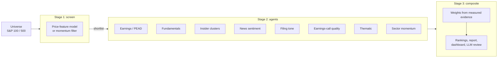

# Auto-Researcher

[](.github/workflows/ci.yml)

[](LICENSE)

A research platform for building equity signals and testing them honestly.

* **Point-in-time data pipelines** for prices, earnings (announcement dates
  inferred from SEC filings), news sentiment, filings and call transcripts.
* **A leakage-safe evaluation toolkit**: a purged walk-forward harness, an
  event-driven strategy simulator, causality and leakage tests, deflated
  statistics and random-portfolio baselines.
* **Filing-reading LLM tools**: a local 8B model fine-tuned to answer
  numerical questions about 10-Ks, retrieval that finds the right table in a
  filing, and a moat tagger that rates competitive advantages from a 10-K with
  quotes checked against the text.
* **Analyst tooling**: a multi-agent pipeline that researches a shortlist of
  stocks (filings, earnings calls, insider trades, news, fundamentals) with a
  Streamlit dashboard and optional LLM review.
* **A research log**: every study below is reproducible from `scripts/`, with
  its report in [docs/results/](docs/results/).

> [!NOTE]
> Earlier versions of this README advertised an ML IC of +0.145, an
> out-of-sample Sharpe of 3.53 and a PEAD IC of +0.22. All three were evaluation
> bugs (label leakage, a "holdout" that was not one, earnings events dated
> before the announcement). [docs/AUDIT.md](docs/AUDIT.md) explains each one and
> how the toolkit now prevents it.

## Research log

| Study | Question | Finding | Report |
| --- | --- | --- | --- |
| Audit | Were the published results real? | No: leakage, a fake holdout and look-ahead event dates. Purging alone moves the ML IC from +0.112 to -0.011 | [AUDIT.md](docs/AUDIT.md) |
| ML ranker | Does the XGBoost screen rank stocks? | No. Purged IC -0.015 (t -0.85) over 105 months; 12-month momentum does as well | [walkforward.md](docs/results/walkforward.md) |
| Features, round 1 | Do 13 published factors, sector-neutral targets or 500 stocks help? | No. Every candidate's IC was between -0.027 and +0.0003; holdout no better than momentum | [feature_research.md](docs/results/feature_research.md) |
| Features, round 2 | Do point-in-time earnings features help the ML model? | No. Surprises predict drift in event time (IC +0.03, t 2.5 over 50 quarters) but too weakly for a monthly ranking | [earnings_feature_research.md](docs/results/earnings_feature_research.md) |
| Earnings drift | Does drift follow surprises vs. analyst consensus? | Yes, in 9 quarters: 40-day drift IC +0.137 (t 3.1), big beats minus big misses +5.2% | [pead_event_study.md](docs/results/pead_event_study.md) |
| Earnings strategy | Is the drift tradeable? | No, not any more. Over 30 years of Alpha Vantage consensus (1996-2026, 502 stocks) long-short makes +4.5%/yr gross (t 1.7) but -2.3% net, and all of the gain is in 1996-2001 (+20.6%/yr gross); since 2010 it is +1.5% gross, -5.5% net. The 2.3-year analyst sample's +9.7% gross (t 1.9) was a favourable window (Alpha Vantage over the same window: +6.9% gross, 0% net). Year-over-year surprises: negative net | [earnings_event_strategy.md](docs/results/earnings_event_strategy.md) |
| Analyst ratings | Do rating changes or price-target revisions predict returns? | No. Pre-registered, 2013-2026: the stock moves on the day of an upgrade or downgrade (+1.6% / -1.9% vs SPY), then nothing. Rating changes earn -0.1%/yr gross after day +1 (t -0.04), -7.1% net (holdout -3.4%); price-target revisions +3.6% gross (t 0.7), noise | [analyst_ratings_strategy.md](docs/results/analyst_ratings_strategy.md) |
| Sentiment | Does the sentiment agent's FinBERT signal predict returns? | No. All 8 pre-specified signal/horizon pairs \|t\| < 1.6; the earlier +0.02 IC came from a leaky backtest | [sentiment_audit.md](docs/results/sentiment_audit.md) |
| Fundamentals, round 3 | Do six published fundamental factors work point-in-time in large caps? | Mostly no. Only accruals passed (IC +0.020, t 2.3; holdout same sign). Gross profitability, asset growth, issuance, FCF and EBIT yields and their composite did not | [fundamental_factors.md](docs/results/fundamental_factors.md) |
| ML valuation gap | Does an ML growth forecast plus DCF find mispriced stocks? | Not established. The forecast beats naive growth estimates (rank corr. 0.35 vs 0.18, t 2.2), and the gap had the best IC (+0.029) and holdout portfolio (+7%/yr vs equal weight), but did not beat a naive-forecast gap by the pre-registered margin | [fundamental_factors.md](docs/results/fundamental_factors.md) |
| FinQA fine-tune | Can a local 8B model learn to answer numerical questions about annual reports with executable programs? | Yes. QLoRA on FinQA's 6,251 training programs lifts Qwen3-8B's execution accuracy on the test set from 53.6% to 76.5% (within 1%: 59% to 79%), above its own free-form answers (71%, p < 1e-9) and the published FinQANet (61%) and APOLLO (71%) results. Runs locally at 3.7 s/question; the test set is public, so absolute scores may be inflated | [finqa_baseline.md](docs/results/finqa_baseline.md) |
| Filing QA | Does the FinQA fine-tune hold up on real filings it has never seen? | Yes. On 980 questions auto-graded from the inline XBRL of 996 10-Ks filed in 2025-26 (526 companies), the fine-tune scores 95.3% within 1% vs 90.7% untuned (p = 2e-5). It got worse on three-year averages, copying a broken 'add 3, divide by 2' program found in 34 FinQA training labels | [filing_qa.md](docs/results/filing_qa.md) |
| Filing retrieval | Can the model find the right table itself, given a whole 10-K? | Mostly. BM25's first table is right 45% of the time (embeddings and hybrid do worse); a local Qwen3-8B re-ranker with thinking, choosing among BM25's top 10, gets 69%, and answers are right within 1% 77.6% of the time vs 53.4% with BM25 alone and 95.3% given the right page (sign test p = 9e-20). On analyst-style rephrased questions: 72.8%. Costs 26 s per question | [filing_rag.md](docs/results/filing_rag.md), [filing_rerank_think.md](docs/results/filing_rerank_think.md) |
| Moat tagger | Can an LLM rate a company's moat sources from its 10-K, citing the text? | Yes, by hand check. Claude Sonnet 5.5 reads Item 1 and five years of financials ($0.04 a company); every quote is checked word for word. On 50 fresh companies, prompt frozen, reviewed blind (name and ticker hidden): 85% of overall calls and 95% of source ratings agreed; every dispute said the moat should be higher, mostly for companies the reviewer recognized. Not yet tested as a return signal | [moat_v3_fresh.md](docs/results/moat_v3_fresh.md) |

**Where the project stands:** no return signal tested here is strong enough to
trade. Post-earnings drift against analyst consensus, the best lead, did not
survive a 30-year history: it was large in the late 1990s and has been too small
to trade after costs since (consistent with published evidence that it has faded
in large caps). The only return signal that passed its pre-registered test is
accruals (IC +0.020, t 2.3), a small effect; the ML valuation gap had the highest
IC (+0.029) but was not significant. The positive results are the filing-reading
tools: a local model that answers numerical questions about real 10-Ks (95% given
the right page, 78% finding the page itself) and a moat tagger that agrees with a
blind human review 85% of the time. Turning these into point-in-time signals is
untested; the moat tags are not point-in-time yet, since the model knows how the
companies turned out.

## Evaluation toolkit

### Walk-forward harness

Any object with `fit(X, y)` / `predict(X)` can be scored:

```python
from auto_researcher.backtest.walk_forward import WalkForwardConfig, run_walk_forward
from auto_researcher.backtest.baselines import FeatureScoreModel
from auto_researcher.screening import UNIVERSES, build_feature_panel, fetch_prices

prices = fetch_prices(UNIVERSES["sp100"](), lookback_days=10 * 365)  # wide panel incl. SPY
features = build_feature_panel(prices, benchmark="SPY")               # (date, ticker) x features

result = run_walk_forward(
    features, prices,
    model_factory=lambda: FeatureScoreModel("tech_resid_mom_252"),
    config=WalkForwardConfig(horizon=21, rebalance_every=21, top_k=10, cost_bps=10),
)
print(result.summary()["ic_mean"], result.summary()["net_ir_vs_equal_weight"])
```

* **Timing.** Features at the close of *t*, entry at the close of *t + lag*,
  label from *t + lag* to *t + lag + horizon*.
* **Purging.** Training rows are used only if their labels were realized before
  the test date (in trading days). On random-walk prices the legacy split lets a
  memorizing model reach IC +0.4; purged, it is 0
  ([leakage canary](tests/test_walk_forward.py)).
* **Honest comparisons.** Spearman IC with Newey-West t-stats; a daily top-k
  portfolio net of costs next to SPY and the equal-weight universe; information
  ratios deflated for the number of variants tried; the Sharpe percentile
  against random portfolios; optional sector-neutral training targets.

### Other tools

| Tool | Module |
| --- | --- |
| Event-driven long/short simulator with causal percentile thresholds | `backtest/event_strategy.py` |
| Published price/volume factors (momentum, 52-week high, beta, MAX, seasonality, sector momentum, ...) | `features/alpha_factors.py` |
| Earnings events: announcement dates from SEC 8-K/10-Q filings, time-series surprises | `features/earnings_events.py` |
| Point-in-time news-sentiment signals | `features/news_signals.py` |
| Point-in-time fundamentals from SEC XBRL filings (first-reported, usable after filing, TTM) | `data/sec_fundamentals.py` |
| Market cap with split handling, EV, value/quality ratios, reverse DCF | `features/valuation.py` |
| Purged walk-forward splits, deflated Sharpe | `validation/` |
| Guard against event data keyed on fiscal period ends | `validation/event_dates.py` |
| Evidence-based weights (signed, sample-size-shrunk ICs) | `composite.py` |
| Analyst rating actions (Yahoo, cross-checked against FMP) | `data/analyst_ratings.py` |
| FinQA programs: parsing, execution, scoring | `llm/finqa.py` |
| Filing pages from inline XBRL, auto-graded questions from tagged facts | `llm/filings.py`, `llm/filing_questions.py` |
| Retrieval within a filing (BM25, embeddings, hybrid) and an LLM re-ranker | `llm/retrieval.py` |
| Moat tagger with quote verification (Ollama or Claude) | `llm/moat.py` |

Every feature builder has a causality test: perturbing future prices or
filings must not change any earlier value
([tests/test_feature_causality.py](tests/test_feature_causality.py)). The
SEC-based announcement dates were checked against an independent source:
exact 71% of the time and two or more days early only 2.9%
(`features/earnings_events.py`).

## Analyst pipeline and dashboard



The pipeline gathers and summarizes evidence about a shortlist for a human
analyst: what the filings, earnings calls, insider trades and news say, where
the agents disagree, and an LLM red-team review. Stage 1 has no measured skill
(see the research log), so treat it as a filter that decides which names the
agents read. The composite weights each agent by its out-of-sample evidence:

| Agent | Evidence | Composite weight |
| --- | --- | --- |
| Earnings drift (PEAD) | Analyst-surprise drift IC +0.090, 9 quarters: tentative | Largest (22%) |
| ML screen | IC -0.025 over 105 months | Zero |
| Sector momentum | IC -0.030 over 33 months | Zero |
| News sentiment | Point-in-time audit: IC +0.016 over 24 months, no edge | Slightly below prior (12%) |
| Fundamentals | Pre-audit evidence had look-ahead and is ignored; point-in-time factors are tested separately in round 3 | Prior (13%) |
| Insider clusters, filing tone, earnings-call quality, thematic | Not yet measured | Prior (13%) |

Weights come from `data/agent_ic.json`, written by
`scripts/calibrate_ic_weights.py` from the reports in `docs/results/`. The
earnings-drift weight rests on the 9-quarter event study; the 30-year history
since found the drift too small to trade, which the weights do not yet reflect.

## Quick start

```bash
git clone https://github.com/AndrewFSee/auto_researcher.git
cd auto_researcher
python -m venv .venv && source .venv/bin/activate   # Windows: .venv\Scripts\activate

pip install -e ".[dev,dashboard]"   # add nlp, llm, research as needed
cp .env.example .env                # API keys; SEC_API_USER_AGENT needs a real contact
pytest -q
```

| Extra | Adds |
| --- | --- |
| `nlp` | torch, transformers, sentence-transformers, ChromaDB (sentiment, filings, transcripts) |
| `llm` | litellm, gpt-researcher, anthropic (LLM review, deep research, moat tagger) |
| `dashboard` | Streamlit |
| `research` | matplotlib, aiohttp (news scrapers) |

### Common commands

```bash
# Dashboard and analyst pipeline
streamlit run app.py
python scripts/run_ranking_low_memory.py --universe sp100 --ml-top 25 --final-top 10
python scripts/run_ranking_low_memory.py --llm-review

# Research studies (each writes docs/results/<name>.md/.json)
python scripts/ml_walkforward_backtest.py --universe sp100 --lookback-years 10
python scripts/feature_research.py
python scripts/earnings_feature_research.py
python scripts/earnings_event_strategy.py
python scripts/sentiment_audit.py
python scripts/analyst_ratings_strategy.py
python scripts/calibrate_ic_weights.py          # refresh agent weights from the reports

# Filing tools (local models served by Ollama; see scripts/README.md)
python scripts/finqa_baseline.py --model qwen3-finqa --modes program
python scripts/filing_rerank_eval.py --sets test test_paraphrased --think --model qwen3-finqa
python scripts/moat_pilot.py report --set fresh --model claude-sonnet-5-5
```

The filing tools read 10-Ks stored by the sister project
[sentiq](https://github.com/AndrewFSee/sentiq) and run models locally in
[Ollama](https://ollama.com); the fine-tuned `qwen3-finqa` model is built from
the FinQA training set (see [finqa_baseline.md](docs/results/finqa_baseline.md)).

The research scripts download prices (yfinance), S&P 500 membership
(Wikipedia) and SEC filing/EPS histories (DefeatBeta) into
`data/research_cache/` on first run. `data/` is local and not in git. Pipeline
outputs go to `data/ranking_results/` (override with
`AUTO_RESEARCHER_RESULTS_DIR`). Docker: `docker compose up --build` serves the
dashboard on port 8501. See [scripts/README.md](scripts/README.md) for every script.

## Project layout

```
src/auto_researcher/
├── backtest/      # walk_forward.py (harness), event_strategy.py, baselines, metrics
├── validation/    # Purged splits, deflated Sharpe, event-date checks
├── features/      # Technical, alpha factors, earnings events, news signals, targets,
│                  # point-in-time fundamental factors, valuation and reverse DCF
├── data/          # Prices (with offline cache), SEC point-in-time fundamentals,
│                  # FMP / Alpha Vantage earnings, news scraper, vector stores
├── llm/           # FinQA programs, filing pages and questions, retrieval, moat tagger
├── agents/        # Sentiment, LLM review, deep research
├── models/        # PEAD, quality-value, insider cluster, filing tone, earnings-call quality,
│                  # sector momentum and rotation, early adopter, XGBoost ranker, growth forecast
├── screening.py   # Stage 1 screen
└── composite.py   # Evidence-based agent weights
scripts/           # Pipeline, research studies and data ingestion (see scripts/README.md)
tests/             # Unit, leakage, causality and accounting tests
docs/              # AUDIT.md and the research reports (docs/results/)
app.py             # Streamlit dashboard
```

## Limitations

* **Survivorship bias.** Universes are current constituent lists. The S&P 500
  studies add each stock only from its index add date, but companies that later
  left the index are missing. Compare against the equal-weight portfolio of the
  same names, and treat absolute returns as optimistic.
* **Short histories.** Point-in-time fundamentals start around 2010 (SEC XBRL),
  dense news coverage in 2024. Earnings consensus goes back to 1996 (Alpha
  Vantage) and analyst rating actions to 2013.
* **Lookahead in LLM judgments.** Models trained on recent text know how
  companies turned out, so LLM ratings of past filings (the moat tags) carry
  hindsight; numbers extracted from a filing do not.
* **Unmeasured agents.** Insider, filing-tone, earnings-call and thematic agents
  have no out-of-sample measurement yet.
* **Research software.** Nothing here is investment advice.

## References

| Topic | Papers |
| --- | --- |
| Backtest overfitting, purged CV | López de Prado (2018); Bailey & López de Prado (2014) |
| Earnings drift | Ball & Brown (1968); Bernard & Thomas (1989); Brandt et al. (2008); Martineau (2021) |
| Momentum, reversal, other factors | Jegadeesh (1990); Jegadeesh & Titman (1993); George & Hwang (2004); Heston & Sadka (2008); Bali, Cakici & Whitelaw (2011); Frazzini & Pedersen (2014) |
| Text and sentiment | Loughran & McDonald (2011); Garcia (2013) |
| Insider trading | Lakonishok & Lee (2001); Cohen, Malloy & Pomorski (2012) |
| Portfolio construction | Markowitz (1952); Ledoit & Wolf (2004); Grinold & Kahn (2000) |

## License

MIT; see [LICENSE](LICENSE).
